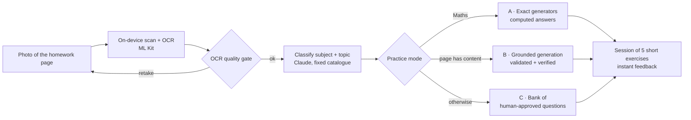

# TPC+

[](https://github.com/WHAIT666/tpc-plus/actions/workflows/backend.yml)

> Photograph a finished homework page. Get fresh practice on the same topic, at the right level, with instant feedback.

TPC+ ("TPC" is Portuguese for *trabalhos para casa*, homework) is an Android tablet app and a Go backend built for one real user: a 5th-grade student in Portugal who struggles with maths. When she finishes her homework, in any subject, she photographs the page. The app works out the subject and the topic and gives her new exercises she has not seen, checked before she ever sees them.

**Status:** M0 (discovery) done, apart from the observation session, the photos and the tablet check · **M1 (exact maths engine) done** · M2 (usable app) planned · see [Roadmap](#roadmap)

---

## The problem

- Homework comes back "done", but nobody knows whether she understood it. When she gets stuck, the class group chat sends her the answer.
- After homework there is no extra practice at her level on what she is learning right now.
- Generic practice apps don't follow her textbook or her class's pace, and a chatbot that makes up questions can't be trusted with a 10-year-old.

## How it works



### Three practice modes

| Mode | Used for | Why it can be trusted |
|---|---|---|
| **A · Exact** | Maths | Exercises and answers are **computed** with exact rational arithmetic (`math/big.Rat`), never generated by a language model. Property tests check thousands of exercises against an independent implementation. |
| **B · Grounded** | Text subjects (History & Geography of Portugal first) | Questions are generated **only from the page**. Each one carries up to three evidence spans that are checked in code, and a separate verifier sees only those spans. Anything uncertain is blocked. |
| **C · Approved bank** | When the page has too little content | Questions a human has already reviewed and approved. The bank grows with use. |

## Engineering highlights

The features below are designed and documented, and get built milestone by milestone. A number goes in the Evidence table only once it has been measured.

- **No answer without proof.** What can be computed is computed. Everything else is grounded in the page and verified, and the remaining risk is measured and stated ([ADR-001](docs/adr/001-no-answer-without-proof.md)).
- **Statistical quality gate.** Human review with severity levels. A topic opens to the child only with at least 100 reviewed questions, 0 critical errors and a Wilson lower bound of at least 93% ([ADR-010](docs/adr/010-statistical-quality-criterion.md), [ADR-015](docs/adr/015-per-topic-review-mode.md)).
- **Privacy by design.** OCR runs on the tablet, images are never stored and only text leaves the device by default ([ADR-003](docs/adr/003-on-device-ocr-text-by-default.md)).
- **Threat-modelled API.** Per-family isolation with tests that prove it, rotating refresh tokens with reuse detection, child/parent/operator roles and transactional idempotency ([ADR-012](docs/adr/012-family-isolation-roles-idempotency.md)).
- **AI cost circuit breaker.** A daily quota derived from the monthly budget, with an atomic reservation before each call. When the budget runs out, mode B turns off and modes A and C keep working ([ADR-013](docs/adr/013-ai-cost-ceiling.md)).

## Evidence

| Metric | Value | How it is measured |
|---|---|---|
| Maths exercises verified by an independent implementation | **90,000**, 0 failures (3 skills × 3 levels × 10,000 seeds, in 0.4 s) | Property tests: an oracle in a separate test package recomputes every answer from the prompt with `int64` ([M1 devlog](docs/devlog/2026-11-20-m1-exact-engine.md)) |
| Answer parser robustness | **25.1 million** fuzzed inputs in 60 s, 0 crashes | `go test -fuzz=FuzzParse`; 10 s on every CI run |
| Topic classification accuracy (top-1 / top-3) | *M4 — not measured yet* | Labelled eval set of real homework photos |
| Mode B pass rate in human review (95% Wilson lower bound) | *M5 — not measured yet* | Stratified review per topic |
| p95 latency per session | *M6 — not measured yet* | Production metrics |
| Average AI cost per session | *M5 — not measured yet* | `ai_usage` table |
| She completes 3 sessions alone on different days | *M2 — not met yet* | Session log |

## Tech stack

| Layer | Choice | Why |
|---|---|---|
| Android app | Kotlin, Jetpack Compose, Material 3, Hilt, Room, Retrofit | Native Android: strong demand in the target job market, direct access to ML Kit |
| Vision | ML Kit Document Scanner + Text Recognition v2 | Runs on the device, so photos never leave the tablet |
| Backend | Go (`net/http`, `log/slog`), modular monolith | Simple to run and test; standard library first |
| Data | PostgreSQL, `pgx`, `sqlc`, `goose` | Real SQL with type-checked queries |
| AI | Claude API (structured outputs, prompt caching) | Classification, grounded generation and verification, all constrained by schemas |
| Quality | Property tests, native fuzzing, testcontainers-go, golangci-lint, ktlint/detekt | Bugs caught before a child sees them |
| Delivery | Docker, GitHub Actions, EU hosting, Caddy | Small, cheap and reproducible |

## Repository layout

```text
backend/
  cmd/practice/       Terminal practice session
  internal/grading/   Answer parser (fuzzed), exact grader, formatting
  internal/engine/exact/  Deterministic generators, registry, property and golden tests
  testdata/golden/    Pinned generator output
android/            Kotlin + Compose app (from M2)
docs/adr/           Architecture decision records
docs/devlog/        What was built, what broke, what was learned
docs/media/         Screenshots, GIFs and videos per milestone
docs/architecture.md, docs/milestones.md, docs/m1-spec.md, docs/m0-discovery.md
```

## Getting started

The backend needs only Go (the version in [`backend/go.mod`](backend/go.mod)), no other dependencies.

```bash
cd backend
go test ./...                                   # 221 tests, including 90,000 property-checked exercises
go run ./cmd/practice -level 3 -n 5             # a practice session in the terminal
go run ./cmd/practice -skill mat.fracoes_somar_subtrair -level 2 -seed 42   # replay a session exactly
```


Skills: `mat.fracoes_equivalentes`, `mat.fracoes_somar_subtrair`, `mat.fracao_de_quantidade`, each with levels 1–3.

## Roadmap

| Milestone | Scope | Status |
|---|---|---|
| M0 · Discovery | Interviews, school report, consent, topic choice | 🟡 Mostly done |
| M1 · Exact engine | Maths generators, grader, parser, property tests, fuzzing, CLI | ✅ Done |
| M2 · Usable app | Kotlin app, manual topic choice, 5-exercise session | 🟡 Planned ([spec](docs/m2-spec.md)) |
| M3 · Data and security | Postgres, families, tokens, idempotency, progress | ⚪ |
| M4 · Scan and classify | ML Kit, OCR gate, classification eval | ⚪ |
| M5 · HGP (modes B + C) | Grounded generation, verifier, review, budget | ⚪ |
| M6 · Production | EU deploy, CI/CD, backups, observability, demo mode | ⚪ |
| M7 · Adaptive and expansion | BKT vs simple rule, more subjects | ⚪ |

Details and done-criteria: [docs/milestones.md](docs/milestones.md).

## Privacy

The user is a minor. Her parents gave written consent before any of her data was used. She is identified only by a nickname. Photos are processed on the tablet and not stored. The real homework photos in the evaluation set stay private and are never committed. All screenshots and videos in this repository use demo mode with made-up data.

## Documentation

- [Architecture](docs/architecture.md)
- [Decision records](docs/adr/)
- [Milestones](docs/milestones.md)
- [M1 specification](docs/m1-spec.md)
- [M2 specification](docs/m2-spec.md)
- [Discovery summary](docs/m0-discovery.md)
- [Devlog](docs/devlog/)

---

Built by André Santos.
