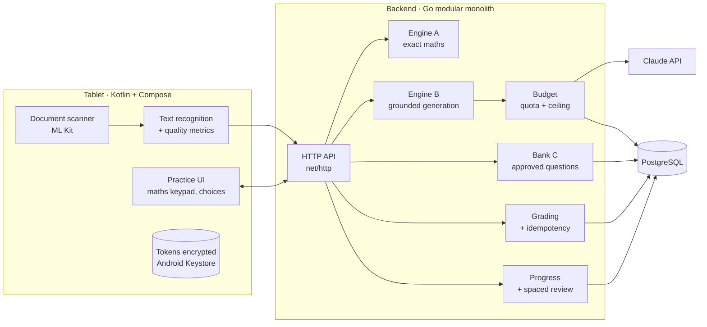
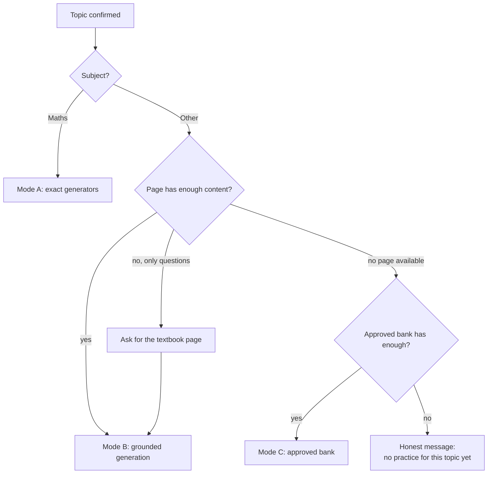

# Architecture

This document describes the target system. Each milestone builds part of it; [milestones.md](milestones.md) says which part.

## System context



The tablet is a thin client: it scans, runs OCR and shows exercises. **Every answer is graded on the server**, so the app has no grading logic that could drift from the backend.

## Practice-mode decision



## Mode B pipeline (M5)

| Step | What happens | If it fails |
|---|---|---|
| 1 · Sufficiency | Classification also decides whether the page has enough content | Ask for the textbook page, or use mode C |
| 2 · Generation | A batch of 8 questions via structured outputs: type, stem, options, key, short explanation, up to 3 evidence spans | Retry once |
| 3 · Deterministic validation | Spans exist in the text, the key is among the options, the format is valid, it is not too similar to the homework or recent sessions | Discard the question |
| 4 · Minimal-context verification | A separate request sees only the spans, the stem and the options, never the key. Result is pass, fail or uncertain | `fail` and `uncertain` are discarded |
| 5 · Review | Conservative mode: a human approves every question. Dynamic mode: a ~10% sample is reviewed | Topic is paused if quality drops |

## Backend layout (planned)

```text
backend/
  cmd/api/                 HTTP server
  cmd/practice/            terminal practice session (M1)
  cmd/eval/                classification and question evaluation
  cmd/review/              human review queue (CLI)
  internal/httpapi/        handlers, middleware, size limits
  internal/authz/          tokens, refresh, family isolation, roles
  internal/ocrgate/        OCR quality rules
  internal/classify/       subject/topic classification + sufficiency
  internal/engine/exact/   mode A
  internal/engine/grounded/ mode B
  internal/verify/         deterministic validation + verifier
  internal/bank/           mode C
  internal/grading/        answer parser, exact grading, idempotency
  internal/progress/       simple rule, spaced review, BKT (M7)
  internal/budget/         quotas, monthly ceiling, usage log
  internal/store/          sqlc queries + migrations
  prompts/                 versioned prompts
  catalog/topics.yaml      subjects and topics (single source of truth)
```

## Cross-cutting rules

- **The page is data, not instructions.** OCR text is delimited in every prompt, the output is bound to a schema, and test fixtures include pages that try to give orders.
- **Logs never contain personal data.** Structured JSON logs (`slog`) with a request ID.
- **Reproducibility.** Every mode A exercise stores its generator version and seed. Every mode B question stores its prompt and model version.
